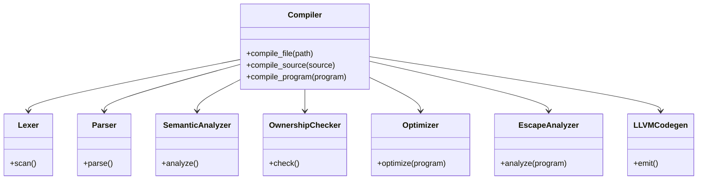
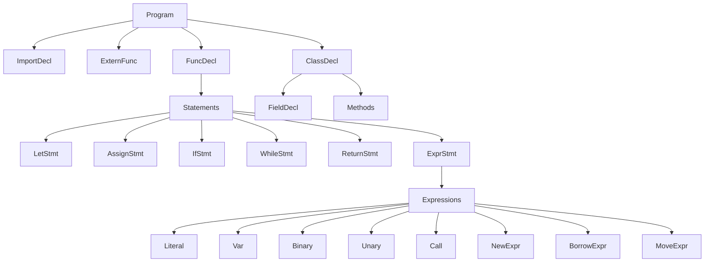
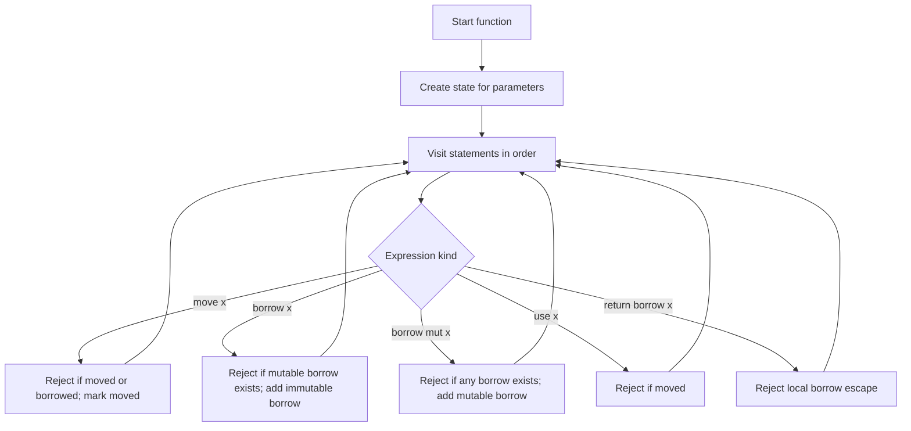

# Design Artifacts

## Compiler Class Diagram



## AST Overview



## Ownership Checking Flow



## Translator Pseudocode

```text
compile_file(path):
    source = read(path)
    imported_programs = resolve_imports(source)
    tokens = lex(source)
    ast = parse(tokens)
    merged_ast = imported_programs + ast
    semantic_analyze(merged_ast)
    ownership_check(merged_ast)
    optimized_ast = constant_fold(merged_ast)
    escape_info = analyze_escapes(optimized_ast)
    llvm_ir = generate_llvm(optimized_ast, escape_info)
    return llvm_ir
```

