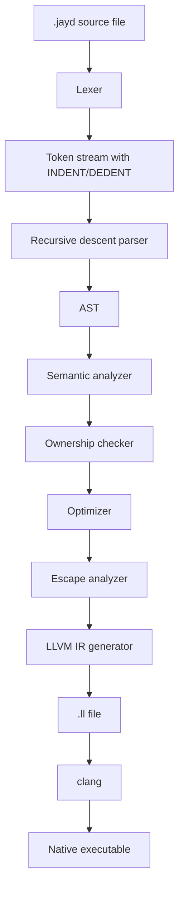

# Translator Architecture

Jayd's translator is a compiler implemented in Python. It accepts `.jayd` source
files and produces LLVM IR. The CLI can then ask `clang` to turn that IR into a
native executable.

## Pipeline



## Major Components

| Component | Responsibility |
| --- | --- |
| `Lexer` | Converts source text into tokens and tracks indentation |
| `Parser` | Builds AST nodes for declarations, statements, and expressions |
| `SemanticAnalyzer` | Performs scope checking, type checking, class validation, and call validation |
| `OwnershipChecker` | Enforces move/borrow/lifetime rules |
| `EscapeAnalyzer` | Marks `new` allocations as stack-like or heap-escaping |
| `Optimizer` | Performs constant folding |
| `LLVMCodegen` | Emits LLVM IR for the executable subset |
| CLI | Provides `check`, `emit-ir`, `build`, and `run` commands |

## Data Flow

1. Source files are read by `Compiler.compile_file`.
2. Imports are resolved recursively from sibling `.jayd` files.
3. The lexer emits structural indentation tokens.
4. The parser produces a `Program` AST.
5. Semantic analysis verifies symbols and types.
6. Ownership analysis verifies memory safety rules.
7. Optimization folds constant expressions.
8. Escape analysis records allocation decisions.
9. Code generation emits LLVM IR.
10. `clang` optionally links the IR into a native executable.

## Error Handling

Compiler diagnostics include phase and source location:

```text
ownership error at 7:17: cannot move 'buffer' while it is borrowed
```

The compiler stops after diagnostics rather than generating invalid native code.

